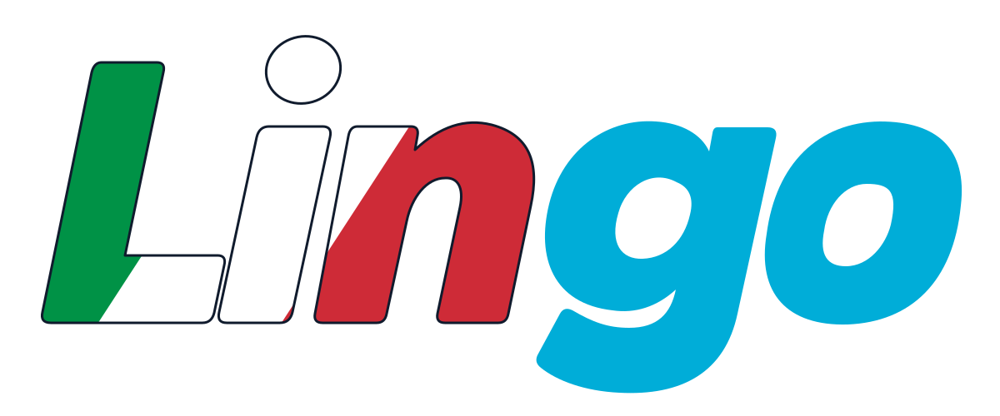

[English](README.md) | **Italiano**

# LinGo

<picture>
  <source media="(prefers-color-scheme: dark)" srcset="assets/brand/wordmark-on-dark.svg">
  
</picture>

**Tokenizzazione italiana a regole, in puro Go, con tipi di token, offset UTF-8
e una suite di valutazione basata su Universal Dependencies.**

LinGo segmenta il testo italiano e riconosce parole, numeri, date,
orari, abbreviazioni, sigle, unità di misura, email, URL, punteggiatura e simboli.
Ogni token conserva il valore originale e la posizione nel testo di partenza.

Il progetto include due profili: uno che mantiene intere le parole con elisione,
come `l'amico`, e uno orientato alle convenzioni dei token di superficie italiani
di Universal Dependencies, che produce `l'` e `amico`.

> **Stato: sviluppo attivo.** Il package dispone di test, fuzzing e baseline su
> un corpus italiano reale. API, regole e convenzioni di segmentazione possono
> ancora cambiare; l'idoneità a un utilizzo in produzione va verificata sui propri
> testi e requisiti.

## Indice

- [Stato attuale](#stato-attuale)
- [Requisiti e installazione](#requisiti-e-installazione)
- [Primo utilizzo](#primo-utilizzo)
- [API e modello dei token](#api-e-modello-dei-token)
- [Profili italiani](#profili-italiani)
- [Riconoscimento e convenzioni](#riconoscimento-e-convenzioni)
- [Interfaccia a riga di comando](#interfaccia-a-riga-di-comando)
- [Universal Dependencies e CoNLL-U](#universal-dependencies-e-conll-u)
- [Risultati e riproducibilità](#risultati-e-riproducibilità)
- [Architettura](#architettura)
- [Test e sviluppo](#test-e-sviluppo)
- [Limiti noti](#limiti-noti)
- [Direzioni di sviluppo](#direzioni-di-sviluppo)
- [Identità visiva](#identità-visiva)
- [Licenza](#licenza)

## Stato attuale

| Area | Disponibile oggi |
| --- | --- |
| Lingua | Profili dedicati all'italiano. |
| Implementazione | Go e libreria standard, senza dipendenze Go esterne. |
| Esecuzione | Locale, senza modelli da scaricare o servizi NLP esterni. |
| Tokenizzazione | Regole deterministiche e lessici di abbreviazioni, sigle e unità. |
| Output | Valore originale, tipo del token, offset iniziale e finale in byte. |
| Profili | Italiano standard e italiano UD per i token di superficie. |
| Strumenti | CLI `lingo`, lettore CoNLL-U e CLI di valutazione `lingo-eval`. |
| Qualità | Suite offline, regressioni linguistiche, fuzzing e controlli con race detector. |
| Valutazione esterna | Baseline su dev e test di UD Italian-ISDT r2.17. |
| Prestazioni | Benchmark ripetibili di throughput e allocazioni; ottimizzazione ancora aperta. |
| Altre lingue europee | Sviluppo futuro; nessun profilo dedicato disponibile al momento. |

Gli impieghi possibili comprendono preparazione di testi per pipeline NLP,
indicizzazione, estrazione di elementi testuali e strumenti che devono riferire
i token al documento originale. La scelta del profilo dipende dalle convenzioni
richieste dall'applicazione o dal corpus di riferimento.

## Requisiti e installazione

Il modulo è:

```text
github.com/espositopasquale/lingo
```

La versione minima dichiarata in [`go.mod`](go.mod) è **Go 1.27.0**.
Per compilare e usare tokenizer, lettore CoNLL-U ed evaluator basta la toolchain
Go. `make` è opzionale e serve per i comandi abbreviati del progetto.

Da un checkout del repository:

```sh
go build ./...
go install ./cmd/lingo ./cmd/lingo-eval
```

I binari vengono installati nella destinazione configurata da Go. Gli esempi
con `go run` nelle sezioni successive funzionano direttamente dalla radice del
repository e usano il codice di quel checkout.

I corpus UD si scaricano separatamente e manualmente per la valutazione esterna.
La tokenizzazione e i test offline funzionano senza quei file.

## Primo utilizzo

```go
package main

import (
	"fmt"

  "github.com/espositopasquale/lingo/tokenizer"
)

func main() {
	text := "L'amico è nella sala."
	tk := tokenizer.NewItalianUD()

	for _, token := range tk.Tokenize(text) {
		fmt.Printf("%q\t%s\t[%d:%d]\n",
			token.Value, token.Type, token.Start, token.End)
	}
}
```

Output:

```text
"L'"    word         [0:2]
"amico" word         [2:7]
"è"     word         [8:10]
"nella" word         [11:16]
"sala"  word         [17:21]
"."     punctuation  [21:22]
```

La tabulazione dell'output dipende dal terminale. Per mantenere `L'amico` come
un'unica parola, usa `tokenizer.NewItalian()`.

## API e modello dei token

### Funzioni disponibili

| API | Utilizzo |
| --- | --- |
| `tokenizer.Tokenize(text)` | Tokenizza con il profilo italiano standard e conserva la punteggiatura. |
| `tokenizer.TokenizeWithoutPunctuation(text)` | Usa il profilo standard ed esclude i token di tipo `Punctuation`. |
| `tokenizer.NewItalian(options...)` | Costruisce un tokenizer italiano standard riutilizzabile. |
| `tokenizer.NewItalianUD(options...)` | Costruisce un tokenizer italiano orientato alle convenzioni UD. |
| `tk.Tokenize(text)` | Restituisce `[]tokenizer.Token` usando il profilo e le opzioni dell'istanza. |

Per elaborare molti testi con lo stesso profilo, costruisci il tokenizer una volta
e riutilizzalo. Le funzioni di comodo costruiscono un'istanza a ogni chiamata.

### Struttura e offset

```go
type Token struct {
	Value string
	Type  TokenType
	Start int
	End   int
}
```

`Start` è incluso ed `End` è escluso. Entrambi sono **offset in byte UTF-8**,
misurati sulla stringa originale. Per ogni token vale:

```go
text[token.Start:token.End] == token.Value
```

Nell'esempio precedente `è` occupa due byte e ha intervallo `[8:10]`. Gli offset
non rappresentano indici di rune o colonne visuali.

Il tokenizer mantiene maiuscole, accenti e grafia originale. Non normalizza
Unicode. Gli accenti combinanti vengono mantenuti nella parola; la sequenza
`e\u0300` rimane distinta dalla rappresentazione precomposta `è`.

Gli spazi e gli a capo non diventano token. Per ricostruire fedelmente il documento
occorre conservare il testo originale e usare gli offset: concatenare i soli
`Value` elimina gli spazi tra i token.

### Tipi di token

| Tipo Go | `String()` | Esempio o significato |
| --- | --- | --- |
| `Word` | `word` | `amico`, `perché`. |
| `Number` | `number` | `1.250,50`; nel profilo UD anche forme come `2,5%`. |
| `Date` | `date` | `31/08/2026`. |
| `Time` | `time` | `14:30`. |
| `Abbreviation` | `abbreviation` | `dott.`, `ecc.`. |
| `Acronym` | `acronym` | Sigle note (`UE`, `M5S`, `CdA`) e iniziali puntate (`C.N.R.`). |
| `Unit` | `unit` | `kg`, `m²`, `°C` nel contesto numerico riconosciuto. |
| `Email` | `email` | `nome@mail.esempio.it`. |
| `URL` | `url` | `https://esempio.it`. |
| `Punctuation` | `punctuation` | Virgole, punti, virgolette e altri segni. |
| `Symbol` | `symbol` | Simboli e caratteri non classificati dalle altre regole. |
| `Unknown` | `unknown` | Valore iniziale dell'enumerazione. |

Queste categorie descrivono il riconoscimento lessicale di LinGo. Le categorie
grammaticali UD, come `NOUN`, `VERB` e `DET`, appartengono a un'altra annotazione.

### Opzioni

L'opzione pubblica attuale è `KeepPunctuation`, abilitata da
`tokenizer.DefaultOptions()`:

```go
options := tokenizer.DefaultOptions()
options.KeepPunctuation = false

tk := tokenizer.NewItalianUD(options)
tokens := tk.Tokenize("L'amico?!")
// Valori: ["L'", "amico"]
```

Le opzioni fornite sostituiscono quelle predefinite. In particolare, il valore
zero `tokenizer.Options{}` ha `KeepPunctuation: false`.

Il filtro rimuove soltanto i token classificati come `Punctuation`: l'apostrofo
interno a una parola o a un prefisso eliso rimane nel suo token. Simboli e
percentuali incorporate in un token numerico UD seguono la propria categoria.

## Profili italiani

| Testo | Standard | UD |
| --- | --- | --- |
| `l'amico` | `l'amico` | `l'`, `amico` |
| `com'è` | `com'è` | `com'`, `è` |
| `po'` | `po'` | `po'` |
| `nella` | `nella` | `nella` |
| `dammelo` | `dammelo` | `dammelo` |
| `e-mail` | `e`, `-`, `mail` | `e-mail` |
| `2,5%` | `2,5`, `%` | `2,5%` |
| `!!!` | `!!!` | `!`, `!`, `!` |

Il profilo UD impiega una lista di prefissi elisi e convenzioni aggiuntive per
composti, possessivi inglesi presenti nel testo italiano, iniziali e alcune forme
numeriche. La separazione delle elisioni è basata su regole: non comporta
un'analisi grammaticale del contesto.

Scegli il profilo standard se vuoi mantenere le parole elise intere nella tua
applicazione. Scegli quello UD se devi confrontare i confini dei token con
annotazioni che seguono quelle convenzioni. Le differenze tra i profili sono
parte del comportamento previsto.

## Riconoscimento e convenzioni

Il motore prova le regole applicabili alla posizione corrente. Vince la regola
con priorità maggiore e, a parità di priorità, il match più lungo. In caso di
ulteriore parità resta il primo match nell'ordine di registrazione.

Le regole specializzate per URL, email, date, orari e abbreviazioni hanno priorità
sulla regola generale per le parole. Questo consente, per esempio, di mantenere
`dott.` e un indirizzo email come token unici.

Alcune convenzioni utili da conoscere:

- I numeri standard seguono la notazione italiana con virgola decimale e gruppi
  delle migliaia separati da punti. Il profilo UD include ulteriori forme come
  intervalli, percentuali, dimensioni `60x60` e anni abbreviati `'90`.
- Le date riconosciute hanno giorno e mese di una o due cifre, anno di quattro
  cifre e separatore coerente `/`, `-` oppure `.`. Gli orari seguono la forma
  ora:minuti. Il riconoscimento della forma non valida il calendario o l'intervallo
  dei valori e non converte il risultato in `time.Time`.
- I lessici integrano i prefissi italiani di Moses e le eccezioni italiane di
  spaCy, adattati alle convenzioni dei due profili, senza dipendenze esterne.
  Il riconoscimento delle abbreviazioni usa un indice per prefisso Unicode e
  sceglie la forma valida più lunga: `sig.ra.` precede `sig.`.
- Una parola tutta maiuscola richiede una voce nel lessico per diventare una
  sigla. Sono ammesse le grafie miste esplicite (`CdA`, `S.p.A.`); `ad`, `Ad`,
  `usa` e `Usa` rimangono parole. Due o più iniziali maiuscole puntate sono
  riconosciute anche senza voce dedicata, con punto finale opzionale: `C.N.R.`,
  `C.N.R`, `R.E.M.`. Questa euristica riconosce la forma, non il significato.
- `No.` è un'abbreviazione solo davanti a una cifra, anche dopo spazi;
  `No. grazie` conserva il punto separato. Le voci già incondizionate `art.` e
  `pp.` rimangono tali. Le iniziali singole (`M. Rossi`) richiedono la maiuscola.
- Le eccezioni `e-mail`, `by-pass`, `c/c`, `e/o` e `n°` sono token di tipo
  `Word` in entrambi i profili. `C.so` è un'abbreviazione. Le eccezioni non
  modificano la politica di punteggiatura (`sett..` → `sett.`, `.`) né quella
  delle elisioni (`all'art.` resta intero nello standard, si divide in UD).
- Le unità vengono riconosciute in un contesto numerico, anche con spazi tra
  numero e unità. Il supporto comprende forme come `3 kg`, `3 m²` e `20 °C`.
- Le regole email gestiscono anche sottodomini. Quelle URL mantengono separata
  la normale punteggiatura finale. Sono regole di tokenizzazione, non validatori
  completi di indirizzi o URL.
- I caratteri non riconosciuti vengono comunque coperti dal fallback `Symbol`.
  Questo non implica una segmentazione completa dei grafemi o delle sequenze emoji.

## Interfaccia a riga di comando

### Tokenizzare testo

```sh
go run ./cmd/lingo -text "L'amico arriva alle 14:30."
go run ./cmd/lingo -ud -text "L'amico è nella sala."
go run ./cmd/lingo -ud -no-punct -text "L'amico è qui?!"
go run ./cmd/lingo -format json -text "Tre parole."
```

La CLI stampa valore, tipo e intervallo in byte. Accetta anche argomenti
posizionali e testo da standard input:

```sh
go run ./cmd/lingo -ud "Un testo italiano."
go run ./cmd/lingo -ud < documento.txt
```

Senza testo, argomenti o input reindirizzato, apre una sessione interattiva.
`exit` e `quit` terminano la sessione. Gli argomenti posizionali vengono uniti
con un singolo spazio; per mantenere la spaziatura di un documento usa standard
input oppure `-text` con una singola stringa.

| Flag | Predefinito | Funzione |
| --- | --- | --- |
| `-text` | Stringa vuota | Testo da tokenizzare; se non vuoto prevale sulle altre sorgenti. |
| `-ud` | `false` | Seleziona il profilo italiano UD. |
| `-no-punct` | `false` | Esclude i token di punteggiatura. |
| `-format` | `text` | Produce una tabella allineata o un array JSON (`text` o `json`). |
| `-version` | `false` | Stampa la versione incorporata nella build e termina. |

Gli oggetti JSON contengono `value`, `type`, `start` ed `end`; gli offset
seguono la stessa convenzione in byte UTF-8 dell'API Go. Le build di rilascio
possono incorporare la versione con `make build VERSION=v0.1.0` (sovrascrivere
`BIN` per scegliere il percorso di output).

### Valutare un corpus

```sh
go run ./cmd/lingo-eval -corpus evaluation/testdata/italian.conllu -min-f1 1
go run ./cmd/lingo-eval -corpus data/ud/italian-isdt/r2.17/it_isdt-ud-dev.conllu -profile ud -max-errors 10
```

| Flag | Predefinito | Funzione |
| --- | --- | --- |
| `-corpus` | Obbligatorio | Percorso di un file CoNLL-U locale. |
| `-profile` | `ud` | Profilo `ud` oppure `default`. |
| `-format` | `text` | Report leggibile oppure `json`. |
| `-max-errors` | `5` | Numero massimo di esempi diagnostici; tutte le frasi vengono valutate. |
| `-min-f1` | `0` | Soglia F1 in `[0,1]`; valori inferiori fanno fallire il comando. |
| `-expect-sha256` | Disabilitato | Richiede un preciso checksum del corpus. |

Il codice di uscita è `0` in caso di successo, `1` per errori di lettura,
valutazione, checksum o soglia F1, e `2` per argomenti non validi. Un report JSON
può essere emesso anche quando la soglia F1 non viene raggiunta: nell'automazione
va controllato il codice di uscita del comando.

## Universal Dependencies e CoNLL-U

[Universal Dependencies](https://universaldependencies.org/) viene usato come
riferimento di annotazione e fonte dei corpus di valutazione. LinGo applica
regole locali: non addestra un modello sui file UD e non esegue chiamate a un
servizio esterno durante la tokenizzazione o la valutazione.

L'integrazione riguarda i **token di superficie**, cioè le unità allineabili al
testo originale. In CoNLL-U una riga con ID `2-3` può rappresentare `nella`, mentre
le righe `2` e `3` descrivono le parole sintattiche `in` e `la`.

Il lettore [`conllu`](conllu/reader.go):

- Usa la forma originale della riga multiword come un solo token di superficie.
- Evita di contare di nuovo i componenti di quel multiword token.
- Esclude dal conteggio dei token i nodi vuoti, con ID come `3.1`.
- Allinea le forme a `# text`, mantenendo gli offset in byte.
- Se `# text` manca, ricostruisce il testo usando `SpaceAfter=No` e `SpacesAfter`
  per gli escape `\s`, `\t`, `\n` e `\r` supportati.
- Segnala errori di formato, struttura o allineamento invece di scartare le frasi
  problematiche senza renderlo visibile.

La stessa distinzione vale per `dammelo`: rimane un token di superficie, senza
espansione automatica in parole sintattiche. Il package non fornisce POS tagging,
lemmatizzazione, dependency parsing o un validatore completo dei grafi UD.

La documentazione dettagliata, con fonti del formato e attribuzioni del corpus,
è nella [guida alla valutazione](docs/evaluation.md).

## Risultati e riproducibilità

I risultati attuali, dopo l'integrazione dei lessici, si riferiscono a
**UD Italian-ISDT r2.17**:

| Set | Frasi | Token gold di superficie | F1 standard | F1 UD | Frasi esatte UD |
| --- | ---: | ---: | ---: | ---: | ---: |
| Dev | 564 | 11.132 | 96,34% | **99,82%** | 555 / 564, pari al 98,40% |
| Test | 482 | 9.680 | 95,89% | **99,71%** | 468 / 482, pari al 97,10% |

I report completi con precisione, recall, conteggi e SHA-256 sono in
[`evaluation/baselines`](evaluation/baselines/README.md), con suffisso
`-lexicons.json`. Le baseline iniziali sono conservate per confronto.

Un token è corretto quando entrambi gli estremi del suo intervallo coincidono
con quelli del token gold. La metrica include la punteggiatura ed è aggregata
sull'intero set:

```text
precision = token corretti / token predetti
recall    = token corretti / token gold
F1        = 2 × token corretti / (token predetti + token gold)
```

La percentuale di frasi esatte richiede che l'intera sequenza di token della frase
corrisponda al gold. I confini delle frasi vengono forniti dal corpus: questi
risultati non misurano sentence splitting, classificazione dei tipi di LinGo,
POS tagging, espansioni sintattiche, UAS o LAS.

Le regole sono state raffinate sul dev; il test è stato valutato dopo quei
raffinamenti. Le successive ripetizioni sugli stessi file verificano la
riproducibilità. L'F1 più basso del profilo standard riflette anche la sua scelta
intenzionale di conservare le elisioni: il confronto misura l'aderenza alle
convenzioni UD, non l'utilità assoluta dei due profili.

La copertura di un singolo treebank non dimostra la stessa accuratezza su testi
social, OCR, dialetti, domini specialistici o altre lingue. I risultati sono una
baseline per questo corpus e questa implementazione.

### Ripetere la valutazione

Scarica manualmente i file dev e test della release r2.17, insieme a `LICENSE.txt`
e al README del corpus, come descritto nella [guida](docs/evaluation.md#external-corpus-ud-italian-isdt-r217).
Posizionali in:

```text
data/ud/italian-isdt/r2.17/
```

Quindi esegui:

```sh
make evaluate-dev
make evaluate-test
```

I target verificano i checksum fissati nel [Makefile](Makefile), producono JSON
e richiedono F1 almeno `0.99`. Un file con contenuto diverso fa fallire il controllo
del checksum. Il set train non è necessario per questa valutazione a regole.

Per una configurazione diversa:

```sh
make evaluate-dev UD_DIR=/percorso/al/corpus MIN_F1=0.995
```

Per conservare un report o lavorare con un altro corpus CoNLL-U locale:

```sh
go run ./cmd/lingo-eval -corpus percorso/corpus.conllu -format json -max-errors 0
```

Il JSON include l'hash dei byte del corpus ed esclude timestamp e tempi di
esecuzione. A parità di dati, codice, profilo e limite diagnostico, il risultato
è ripetibile. `-expect-sha256` consente di imporre lo stesso input nelle esecuzioni
successive. I corpus esterni e i report locali sotto `evaluation/results/` sono
esclusi dal versionamento tramite [`.gitignore`](.gitignore).

## Architettura

| Percorso | Responsabilità |
| --- | --- |
| [`tokenizer/`](tokenizer/) | API, profili italiani, opzioni, tipi e lessici. |
| [`rules/`](rules/) | Cursore UTF-8, regole di riconoscimento e selezione dei match. |
| [`conllu/`](conllu/) | Lettura e allineamento dei token di superficie CoNLL-U. |
| [`evaluation/`](evaluation/) | Metriche, diagnostica, fixture originali e baseline. |
| [`cmd/lingo/`](cmd/lingo/) | Tokenizzazione da CLI e sessione interattiva. |
| [`cmd/lingo-eval/`](cmd/lingo-eval/) | Valutazione di un corpus locale e soglie di qualità. |
| [`docs/evaluation.md`](docs/evaluation.md) | Protocollo di valutazione, dati e riferimenti. |
| [`assets/brand/`](assets/brand/) | Loghi, icone, esportazioni e guida visiva. |

Il tokenizer avanza sulla stringa originale. Salta gli spazi, interroga il motore,
emette il match selezionato e riparte dal suo estremo finale. Il motore rifiuta
match vuoti, fuori limite o con un inizio diverso dalla posizione richiesta.

Il contratto di una regola è:

```go
type Rule interface {
	Name() string
	Priority() int
	Match(text string, start int) (Match, bool)
}
```

`rules.NewEngine` permette di assemblare regole a livello del motore. L'API
pubblica di `Tokenizer` espone attualmente i due costruttori italiani; non offre
ancora un costruttore generico per collegare un motore personalizzato. Per
modificare un profilo del package occorre intervenire sulla sua costruzione e
aggiungere regressioni per il comportamento desiderato.

## Test e sviluppo

```sh
go test ./...
make check
make evaluate-fixtures
make benchmark
go test ./tokenizer -run '^$' -fuzz FuzzTokenizerDoesNotPanic -fuzztime 10s -parallel 2
```

| Comando | Controllo |
| --- | --- |
| `go test ./...` oppure `make test` | Test unitari, regressioni e seed del fuzzing. |
| `make check` | `go vet` e test con race detector; quest'ultimo richiede un ambiente Go/CGO compatibile. |
| `make evaluate-fixtures` | F1 pari a 1 sui 22 esempi originali del repository. |
| `make evaluate` | Fixture offline e valutazione del dev esterno. |
| `make evaluate-dev` | Corpus dev con checksum e soglia F1. |
| `make evaluate-test` | Corpus test con checksum e soglia F1. |
| `make benchmark` | Throughput e allocazioni dei due profili, riutilizzando il tokenizer; tre esecuzioni. |

La fixture [`evaluation/testdata/italian.conllu`](evaluation/testdata/italian.conllu)
contiene **22 frasi originali e 164 token gold**. Le colonne POS e dipendenze sono
segnaposto strutturali: la fixture verifica la segmentazione, non l'annotazione
grammaticale. Il suo punteggio perfetto è un controllo di regressione su esempi
curati e va distinto dai risultati sui corpus esterni.

I test coprono anche offset UTF-8, accenti combinanti, classificazione di parole
e sigle, unità, URL, email, multiword token, nodi vuoti, input CoNLL-U non valido,
metriche calcolate su esempi noti, checksum e determinismo dei report. Il fuzzing
esercita entrambi i profili e verifica progressione, copertura del testo e coerenza
tra valori e intervalli.

Le misure di velocità dipendono da macchina, versione Go e testi utilizzati.
Il repository non pubblica una superiorità prestazionale dimostrata rispetto
ad altre librerie. I benchmark servono a osservare e confrontare le revisioni
nelle stesse condizioni; ottimizzazione del motore e allocazioni restano aree
di lavoro.

Se la cache Go predefinita è in sola lettura, indica una directory scrivibile:

```sh
GOCACHE=/tmp/lingo-build-cache make check
```

## Limiti noti

- Il supporto linguistico dedicato riguarda l'italiano. Non è presente un
  rilevamento automatico della lingua o un catalogo di profili europei.
- Le regole e i lessici non coprono ogni elisione, abbreviazione, nome proprio o
  convenzione di dominio. Alcune ambiguità richiedono contesto linguistico.
- Percentuali, intervalli, trattini e altre forme possono essere segmentati
  diversamente nei singoli treebank. Il profilo UD non implica conformità perfetta
  a tutte le annotazioni UD italiane.
- Il supporto Unicode conserva il testo e gestisce lettere e accenti combinanti,
  ma non costituisce un'implementazione completa di UAX #29 o dei cluster grafemici.
- Date, orari, numeri, email e URL sono riconosciuti con euristiche lessicali;
  non sostituiscono la validazione e il parsing dei valori nell'applicazione.
- L'API di tokenizzazione elabora una stringa completa e restituisce una slice.
  Non è disponibile un tokenizer incrementale su `io.Reader`; la CLI legge
  interamente lo standard input prima di tokenizzarlo.
- L'evaluator allinea esattamente `FORM` e testo originale e interrompe la
  valutazione in caso di disallineamento. Non corregge o normalizza il corpus
  automaticamente. Il lettore ha un limite di 16 MiB per riga.
- Il package non include segmentazione delle frasi, lemmatizzazione, tagging,
  analisi delle dipendenze o tokenizzazione BPE/WordPiece per modelli linguistici.

## Direzioni di sviluppo

Le seguenti sono direzioni future, non funzionalità già disponibili:

1. Ampliare la valutazione italiana a generi e domini differenti, registrando
   risultati e casi di errore per corpus.
2. Rafforzare le convenzioni per apostrofi, abbreviazioni, composti e numeri,
   mantenendo esplicite le differenze tra profili.
3. Ottimizzare riconoscimento dei lessici, scansione e allocazioni sulla base
   dei benchmark.
4. Separare regole comuni, dati linguistici e convenzioni regionali per rendere
   più semplice la costruzione di nuovi profili.
5. Introdurre progressivamente altre lingue europee, accompagnando ogni lingua
   con fixture, corpus di riferimento e risultati riproducibili.
6. Consolidare l'API pubblica e valutare interfacce per personalizzazione e
   tokenizzazione incrementale.

Per contribuire, includi un esempio minimo, il profilo interessato, i token
attesi e la motivazione della convenzione adottata. Una correzione dovrebbe avere
un test di regressione ed essere confrontata sul dev; il test esterno va riservato
alle verifiche finali, evitando di usarlo per scegliere le regole.

## Identità visiva

Il logo conserva `Lin` nel tricolore italiano diagonale e `go` nell'azzurro Go.
Sono disponibili varianti per sfondi chiari e scuri, icone, monogramma, favicon,
stampa monocromatica e condivisione social.

- [Guida agli asset](assets/brand/README.md)
- [Anteprima delle varianti](assets/brand/preview.png)
- [Kit completo scaricabile](assets/lingo-brand-kit.zip)

La rigenerazione delle immagini usa strumenti separati dal package Go; i dettagli
e i requisiti sono nella guida agli asset.

## Licenza

Il codice del progetto è distribuito secondo la **GNU GPL versione 3** contenuta
in [`LICENSE`](LICENSE). I corpus esterni conservano le proprie licenze e
attribuzioni, da mantenere insieme ai dati scaricati.
Le note per i lessici adattati sono in
[`THIRD_PARTY_NOTICES.md`](THIRD_PARTY_NOTICES.md).
