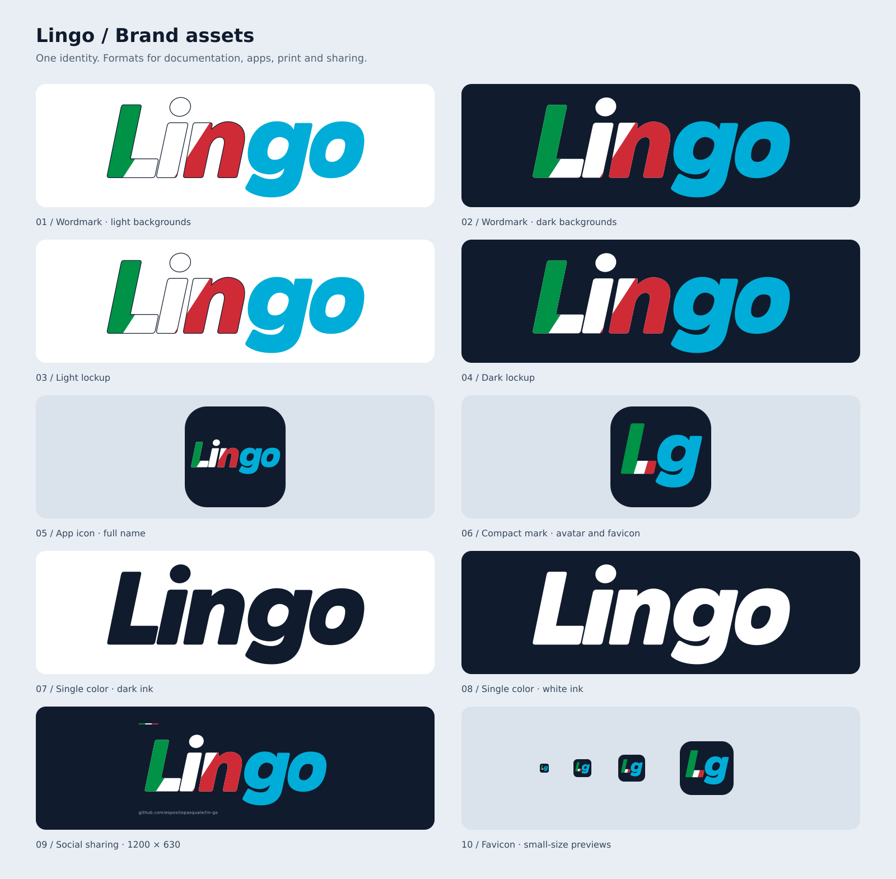

# Lingo brand assets



The identity keeps **Lin** in a continuous diagonal Italian tricolor and **go**
in Go cyan. The compact **Lg** monogram uses a tricolor L and a cyan g.
The vector artwork is a clean adaptation of the original generated concept,
which is preserved at [`../lingo-icon.png`](../lingo-icon.png).

## Choose an asset

| Use | SVG | PNG |
| --- | --- | --- |
| README, header or slide on a light background | [wordmark-on-light.svg](wordmark-on-light.svg) | [1200 × 500](wordmark-on-light.png) |
| README, header or slide on a dark background | [wordmark-on-dark.svg](wordmark-on-dark.svg) | [1200 × 500](wordmark-on-dark.png) |
| Logo with its own white background | [logo-light.svg](logo-light.svg) | [1200 × 500](logo-light.png) |
| Logo with its own navy background | [logo-dark.svg](logo-dark.svg) | [1200 × 500](logo-dark.png) |
| App icon, full name | [icon.svg](icon.svg) | [512 × 512](icon.png), [1024 × 1024](icon-1024.png) |
| Avatar, compact app icon | [monogram.svg](monogram.svg) | [512 × 512](monogram.png) |
| Single-color printing on light surfaces | [mono-dark.svg](mono-dark.svg) | [1200 × 500](mono-dark.png) |
| Single-color printing on dark surfaces | [mono-light.svg](mono-light.svg) | [1200 × 500](mono-light.png) |
| Repository / Open Graph social image | [social-card.svg](social-card.svg) | [1200 × 630](social-card.png) |
| Browser favicon | [favicon.svg](favicon.svg) | [16](favicon-16.png), [32](favicon-32.png), [48](favicon-48.png), [64](favicon-64.png), [128](favicon-128.png), [256 px](favicon-256.png) |
| Legacy / desktop browser favicon | [favicon.ico](favicon.ico), containing 16, 32, 48 and 256 px frames | — |
| Apple touch icon, opaque square background | — | [180 × 180](apple-touch-icon.png) |

Download the complete [brand kit ZIP](../lingo-brand-kit.zip), including the SVG
masters, raster exports, original concept, and generator.

## Colors and placement

| Color | Hex |
| --- | --- |
| Italian green | `#009246` |
| White | `#FFFFFF` |
| Italian red | `#CE2B37` |
| Go cyan | `#00ADD8` |
| Navy | `#101B2D` |

- Wordmarks and monochrome variants have transparent backgrounds. The light-background
  wordmark includes a fine navy outline around **Lin** so its white band remains visible.
- Prefer SVG whenever supported. All logo lettering is drawn as vector paths and
  does not require fonts. The social card's repository URL is live text with a
  system sans-serif fallback; its PNG is ready to publish with fixed typography.
- Keep the exported proportions and padding. Avoid cropping or stretching the lettering.
- Recommended minimum display widths: 180 px for the horizontal wordmark, 128 px
  for the full-name app icon, and 32 px for the compact mark. Dedicated 16 px favicon
  output is provided for browser tabs.
- Monochrome variants intentionally replace the brand colors with one ink color.
- The light/dark labels describe the intended **background**, except `mono-dark`
  and `mono-light`, which describe the **ink**.

## GitHub README

```html
<picture>
  <source media="(prefers-color-scheme: dark)" srcset="assets/brand/wordmark-on-dark.svg">
  
</picture>
```

## Website metadata

Copy the chosen assets to your site's public directory and adjust these URLs to
match where you serve them. Set `og:image` to the absolute public URL of the PNG.

```html
<link rel="icon" href="/assets/brand/favicon.ico" sizes="any">
<link rel="icon" href="/assets/brand/favicon.svg" type="image/svg+xml">
<link rel="apple-touch-icon" href="/assets/brand/apple-touch-icon.png" sizes="180x180">
```

## Regenerate

```sh
python3 assets/brand/generate.py
```

The generator uses only Python's standard library and the system's **librsvg**,
**Cairo**, **GLib** and **GObject** shared libraries for SVG rendering. No network
access, Python packages, or additional Go dependencies are needed. On Debian or
Ubuntu these libraries are supplied by the `librsvg2-2`, `libcairo2`, and GLib
runtime packages; GLib package naming varies by distribution version.

To regenerate just the SVG assets without the rendering libraries:

```sh
python3 assets/brand/generate.py --svg-only
```

Edit the paths and palette in `generate.py`, then regenerate. This keeps every
variant consistent. A full run also rebuilds `../lingo-brand-kit.zip`; the
SVG-only command leaves existing raster exports and the ZIP unchanged.
